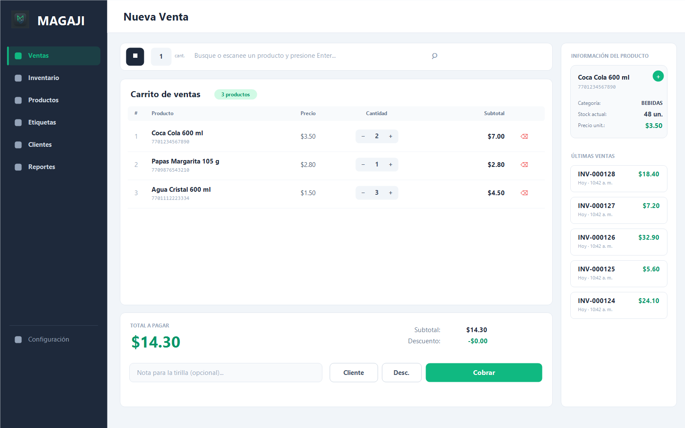
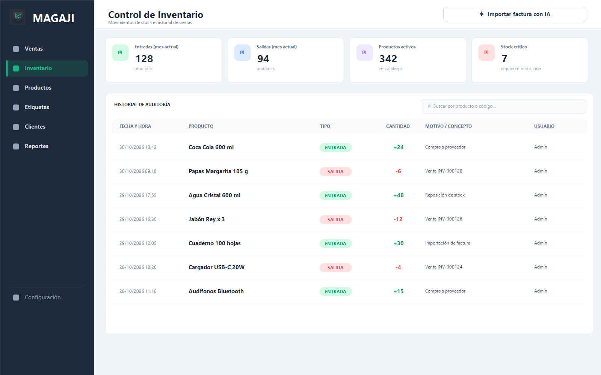
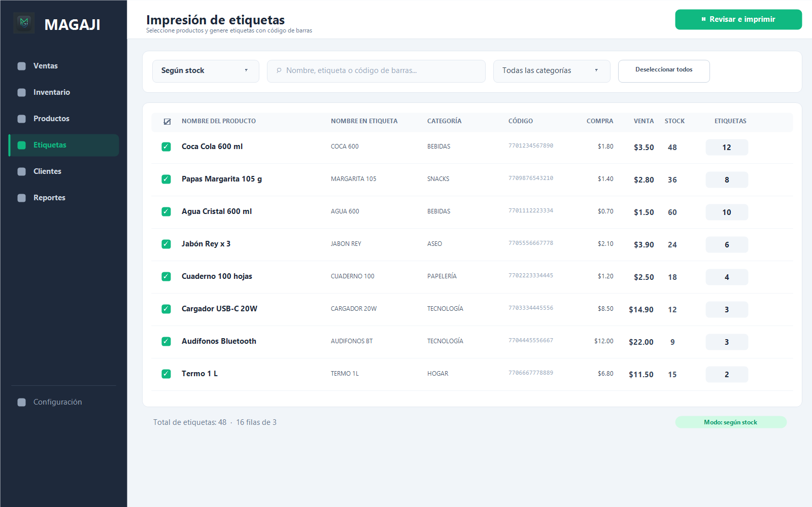
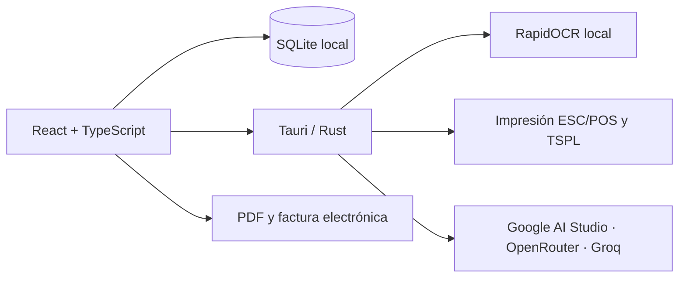

<div align="center">


<h1>MAGAJI</h1>

**Punto de venta, inventario y facturación para negocios que quieren vender mejor.**

Aplicación de escritorio para Windows que centraliza ventas, stock, clientes, etiquetas, reportes y facturación en un solo lugar. Rápida, local y sin suscripciones.

[](https://github.com/LasciaStare/MAGAJI/releases)
[](LICENSE)
[](https://github.com/LasciaStare/MAGAJI/releases)
[](https://tauri.app)
[](https://react.dev)
[](https://www.typescriptlang.org)

[Características](#características-principales) · [Capturas](#capturas-de-pantalla) · [Instalación](#instalación) · [Desarrollo](#desarrollo) · [Documentación](#documentación)

</div>

---

## Capturas de pantalla

<p align="center">
  
</p>

<table>
  <tr>
    <td width="33%" valign="top">
      
      <br />
      <sub><b>Inventario</b> — entradas, salidas, auditoría e historial de ventas.</sub>
    </td>
    <td width="33%" valign="top">
      
      <br />
      <sub><b>Etiquetas</b> — impresión masiva TSPL con código de barras.</sub>
    </td>
    <td width="33%" valign="top">
      
      <br />
      <sub><b>Reportes</b> — métricas, gráficas y stock crítico en tiempo real.</sub>
    </td>
  </tr>
</table>

---

## ¿Qué es MAGAJI?

MAGAJI es un sistema de punto de venta (POS) e inventario diseñado para pequeños y medianos negocios que necesitan operar rápido, sin depender de internet ni de plataformas externas.

Toda la operación —productos, ventas, clientes, movimientos, configuración y respaldos— se guarda localmente en una base de datos SQLite. La importación inteligente de facturas es la única función que utiliza servicios externos, y solo cuando el usuario lo decide.

### Estado del proyecto

MAGAJI **1.2.8** es una versión estable con instalador para Windows x64. Incluye OCR local, integración con proveedores de IA, impresión térmica y de etiquetas, respaldos automáticos y documentación técnica para operación y desarrollo.

### Pensado para

- Tiendas de barrio, minimercados y papelerías.
- Negocios con venta por mostrador y control de stock.
- Comercios que imprimen etiquetas con código de barras.
- Equipos que necesitan reportes claros sin configurar servidores.

---

## Características principales

### Punto de venta ágil

- Búsqueda de productos por nombre o código de barras, con soporte para lector.
- Ingreso rápido de cantidades y atajos de teclado.
- Carrito con edición de cantidades, descuentos y notas para la tirilla.
- Asignación de cliente o venta a **Consumidor Final**.
- Cobro en un paso y confirmación inmediata.
- Historial de últimas ventas con detalle, reimpresión, PDF, edición y anulación.
- La anulación devuelve automáticamente las unidades al inventario.

### Inventario y catálogo

- Catálogo con categoría, precio de compra, precio de venta, stock y stock mínimo.
- Nombre corto para etiquetas (máximo 16 caracteres).
- Alertas de stock crítico y reposición.
- Registro de entradas y salidas con motivo, usuario y fecha.
- Historial de auditoría y de ventas en una sola vista.
- Validaciones para evitar códigos duplicados y movimientos inconsistentes.

### Etiquetas y códigos de barras

- Impresión masiva de etiquetas en formato TSPL de tres columnas.
- Dos modos de cantidad: **según stock** o **personalizada por producto**.
- Selección individual, por rango con **Shift + clic** o de todos los resultados visibles.
- Búsqueda por nombre, nombre de etiqueta o código, con filtro por categoría.
- Revisión previa con stock y cantidad de etiquetas antes de imprimir.
- Códigos de fábrica de hasta 13 dígitos y generación automática de códigos internos RCN con prefijo `20` para productos sin código.
- Límite de 50.000 etiquetas por trabajo.

### Clientes y fundaciones

- Directorio con documento único, teléfono, correo, dirección y notas.
- Clasificación de clientes normales y miembros de fundaciones.
- Gestión de fundaciones con código de miembro.
- Campos personalizados configurables para adaptar el formulario al negocio.
- Creación rápida de clientes desde el punto de venta.
- Eliminación con reasignación de ventas para no perder historial.

### Reportes y análisis

- KPIs de ventas netas, valor del inventario y stock crítico.
- Comparativa de **ventas vs. compras** por rango de fechas.
- Distribución de productos por categoría con filtro interactivo.
- Niveles de stock por producto y resaltado de artículos críticos.
- Exportación del inventario a CSV compatible con Excel.

### Impresión y facturación

- Tirilla térmica ESC/POS para impresoras de 58 mm y 80 mm.
- Diseño de tirilla totalmente editable: logo, textos, separadores, orden, tamaño, negrita y variables.
- Reimpresión de ventas históricas.
- Generación de PDF en dos formatos: tirilla o factura electrónica en carta.
- Factura electrónica con QR, IVA y CUFE representativo.
- Datos del negocio, NIT/RUC, régimen, resolución y pie de página configurables.

> La factura electrónica de MAGAJI es una representación gráfica para uso operativo. No sustituye los servicios de facturación electrónica certificados ante la DIAN u otra autoridad tributaria.

### Importación inteligente de facturas

- **OCR local** con RapidOCR y modelos PP-OCRv6 incluidos en el instalador. No requiere Python en el equipo del usuario.
- Análisis opcional con IA usando **Google AI Studio (Gemini)**, **OpenRouter** o **Groq**.
- Catálogo de modelos actualizable desde la aplicación, con búsqueda y filtro de modelos gratuitos en OpenRouter.
- Tabla editable con nombres, etiqueta, cantidades, costos, precios, categoría y código de barras.
- Asociación asistida con productos existentes por código o nombre.
- Borrador persistente y control de progreso para evitar ingresos duplicados.
- Revisión obligatoria antes de guardar.

El OCR funciona sin conexión. El análisis con IA requiere internet y una clave del proveedor elegido. La clave se guarda únicamente en el almacenamiento local del equipo y nunca se incluye en el instalador.

### Respaldos y seguridad

- Respaldos manuales y automáticos de la base de datos.
- Archivos comprimidos `.db.gz` con rotación por límite de copias.
- Carpeta de destino local o sincronizada con Google Drive, OneDrive u otro servicio.
- Acceso protegido por contraseña con hash SHA-256.
- Contraseña inicial: `admin` (cámbiala desde **Configuración → Contraseña**).
- Datos almacenados localmente: no se envía la base de datos a ningún servidor.

### Configuración a tu medida

- Datos del negocio, IVA, régimen y resolución.
- Selección de impresora térmica y de etiquetas instaladas en Windows.
- Tamaño de papel, escala y negrita de la tirilla.
- Editor visual del contenido de la tirilla.
- Programación de respaldos y retención de copias.
- Cambio de contraseña y ajustes de IA.

---

## Stack tecnológico

| Capa | Tecnologías |
| --- | --- |
| Interfaz | React 19, TypeScript 5.8, Tailwind CSS 4, React Router 7 |
| Componentes y gráficas | Lucide React, Recharts |
| Escritorio | Tauri 2, Rust |
| Base de datos | SQLite mediante `tauri-plugin-sql` |
| Documentos | jsPDF, qrcode |
| OCR | RapidOCR, ONNX Runtime, modelos PP-OCRv6 Small |
| IA | Google AI Studio, OpenRouter, Groq |
| Build | Vite 7, npm |

---

## Instalación

### Para usuarios

1. Descarga el instalador más reciente desde [Releases](https://github.com/LasciaStare/MAGAJI/releases).
2. Ejecuta el instalador NSIS y sigue las instrucciones.
3. Abre MAGAJI e inicia sesión con la contraseña inicial `admin`.
4. Cambia la contraseña en **Configuración → Contraseña**.

**Requisitos**

- Windows 10 u 11 de 64 bits.
- WebView2. Si no está instalado, el instalador lo descarga automáticamente.
- Conexión a internet solo para la instalación de WebView2 (si falta) y para el análisis de facturas con IA.

> El instalador incluye los modelos de OCR, las bibliotecas de ONNX Runtime y las dependencias de Visual C++. No necesitas instalar Python, ONNX ni Visual C++ por separado.

### Para desarrollo

**Requisitos**

- Node.js 22 o superior y npm.
- Rust estable y las dependencias de Tauri para Windows.
- Git.

```bash
git clone https://github.com/LasciaStare/MAGAJI.git
cd MAGAJI
npm ci
npm run tauri dev
```

Para generar el instalador:

```bash
npm run tauri build
```

El instalador NSIS se genera en `src-tauri/target/release/bundle/nsis/`.

> `npm run tauri dev` y `npm run tauri build` preparan y verifican automáticamente los recursos de OCR. La primera vez requieren conexión para descargar los modelos.

---

## Desarrollo

### Comandos disponibles

| Comando | Descripción |
| --- | --- |
| `npm run dev` | Inicia solo el frontend en el navegador (algunas funciones requieren Tauri). |
| `npm run build` | Verifica TypeScript y genera la build de producción. |
| `npm run preview` | Previsualiza la build de producción. |
| `npm run tauri dev` | Inicia la aplicación completa con Tauri y Rust. |
| `npm run tauri build` | Genera el instalador de Windows. |
| `npm run ocr:prepare` | Descarga y verifica los recursos de OCR. |
| `npm run test:etiquetas` | Ejecuta las pruebas de etiquetas. |
| `npm run test:facturas` | Ejecuta las pruebas del importador de facturas (requiere Python para SQLite temporal). |
| `cargo test --release --manifest-path src-tauri/Cargo.toml --lib` | Ejecuta las pruebas del backend Rust. |

### Arquitectura



La lógica de negocio vive en TypeScript. El backend Rust se encarga de la ventana, los plugins de Tauri, la impresión RAW, el OCR local y la comunicación con los proveedores de IA.

### Estructura del proyecto

```text
src/
  components/     Componentes reutilizables de la interfaz
  config/         Configuración de campos y formularios
  database/       Conexión SQLite, esquema y acceso a datos
  pages/          Ventas, Inventario, Productos, Etiquetas, Clientes, Reportes, Configuración
  services/       Respaldos e integración con proveedores de IA
  utils/          Facturación, ESC/POS, TSPL, autenticación y utilidades
  App.tsx         Rutas y estado principal de la aplicación
  App.css         Tailwind CSS y tokens de diseño

src-tauri/
  src/            Backend Rust: impresión, OCR y análisis de facturas
  resources/      Modelos y licencias de OCR
  icons/          Iconos de la aplicación

docs/
  capturas/       Capturas usadas en el README
  assets/         Recursos gráficos
  OCR-DISTRIBUCION.md
  MODELOS-IA.md
  CODIGOS_BARRAS.md

scripts/          Preparación de OCR y pruebas de desarrollo
```

### Convenciones

- TypeScript en modo estricto, sin `any` sin justificación.
- Componentes funcionales con hooks.
- Nombres de dominio en español: `producto`, `venta`, `cliente`, `stock`, `cantidad`.
- Acceso a datos siempre mediante `getDbConnection()` en `src/database/db.ts`.
- Errores de negocio con `ErrorNegocio` y mensajes traducidos en la interfaz.
- Tailwind CSS con los tokens `pos-dark`, `pos-bg`, `pos-primary` y `pos-primary-dark`.

---

## Pruebas

```bash
# Frontend y TypeScript
npm run build

# Etiquetas
npm run test:etiquetas

# Importador de facturas (requiere Python en desarrollo)
npm run test:facturas

# Backend Rust
cargo test --release --manifest-path src-tauri/Cargo.toml --lib
```

Las pruebas del importador usan una base SQLite temporal y llamadas simuladas a la IA. Python solo se utiliza en ese entorno de desarrollo; la aplicación distribuida no lo requiere.

---

## Documentación

- [Distribución de OCR](docs/OCR-DISTRIBUCION.md)
- [Selección de modelos de IA](docs/MODELOS-IA.md)
- [Sistema de códigos de barras](docs/CODIGOS_BARRAS.md)
- [Guía de contribución](CONTRIBUTING.md)
- [Licencia](LICENSE)

---

## Contribuir

Las contribuciones son bienvenidas. Antes de abrir un pull request:

1. Lee [`CONTRIBUTING.md`](CONTRIBUTING.md).
2. Usa commits semánticos (`feat:`, `fix:`, `docs:`, `refactor:`).
3. Verifica que `npm run build` pase.
4. Prueba los flujos que afecten al usuario.
5. Actualiza la documentación cuando corresponda.

---

## Licencia

MAGAJI se distribuye bajo la licencia **Apache 2.0**. Consulta [`LICENSE`](LICENSE) para más detalles.

---

## Autores

Desarrollado por **Jose** y **Christian Menco** para la gestión de inventario y ventas de pequeños y medianos negocios.

<div align="center">

**MAGAJI** · Hecho para vender mejor.

</div>
